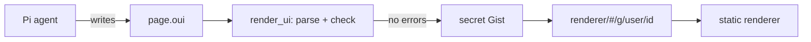

# pi-oui

Make web pages in [Pi](https://pi.dev/) and share them with a link, like
Claude artifacts.

The agent writes the page in
[OpenUI Lang](https://www.openui.com/docs/openui-lang), publishes it and gives
you a link. Anyone with the link can open the page in a browser. The reader
needs no Pi, no account and no login.

A page can use only the components of the
[OpenUI](https://github.com/thesysdev/openui) library. It cannot contain HTML or
scripts, so a shared page cannot run code that a model wrote.

## Install

Install the package from npm:

```fish
pi install npm:pi-oui
```

Add `-l` to install it only for the current project.

To publish pages, install the [GitHub CLI](https://cli.github.com) and run
`gh auth login`. Each published page goes into a secret Gist on this account.

To update or remove the package:

```fish
pi update --extension npm:pi-oui
pi remove npm:pi-oui
```

## Use

1. Start Pi and ask for a page, for example "make a dashboard of these
   numbers".
2. The agent writes the page, publishes it and gives you the link. If the page
   may contain secrets, Pi shows them and you confirm first.
3. Send the link. Anyone can open the page in a browser.
4. To change the page, ask the agent. The link stays the same. GitHub caches
   the page, so a change can take about 5 minutes to show.

To change a page that someone else shared, give the agent its link:

```fish
pi "remix https://ssiyad.github.io/pi-oui/#/g/<username>/<gist-id>"
```

For the tools, live data, the settings and the security rules, see the
[package README](packages/pi/README.md).

## How it works



The project has three parts:

1. **The Pi package.** It adds tools and a skill to Pi. The agent
   uses them to write, check and publish pages.
2. **The renderer.** A static React app on GitHub Pages. It renders pages with
   the OpenUI components.
3. **Storage.** A secret GitHub Gist on your `gh` account holds each published
   page. The link holds only your GitHub username and the Gist ID. It never
   holds the page.

There is no backend. We write no components and no CSS. OpenUI gives the
components, the themes and the prompt that teaches the model to use them.

## Repository layout

The repository is an npm workspace:

```text
packages/
  pi/        # the Pi package: tools, skill, Gist client
  renderer/    # Vite + React app for GitHub Pages
scripts/
  library.ts      # writes library.spec.json and reference.md into packages/pi
  size.mjs        # prints the size of each file in the renderer build
docs/
  design.md          # the design
  spike-phase-1.md   # what the phase 1 spike found
```

## Develop

You need Node 24 and npm.

Install, build, test and type check from the repository root:

```fish
npm install
npm run build   # library spec, skill reference, renderer
npm test
npm run check
```

Load the package in Pi without installing it:

```fish
pi -e packages/pi/src/index.ts --skill packages/pi/skills/openui-page
```

To try the renderer alone, run `npm run dev -w packages/renderer`.

## Deploy the renderer

The workflow in `.github/workflows/pages.yml` builds the renderer and deploys it
to GitHub Pages. It runs on each push to `main` that changes the renderer, and
you can also start it by hand.

1. In the repository settings, set the Pages source to GitHub Actions.
2. Push to `main`, or run the "Renderer" workflow.

Links point to `https://ssiyad.github.io/pi-oui/` by default. To use another
renderer, set `PI_UI_RENDERER_URL`.

## References

- [OpenUI Lang specification](https://www.openui.com/docs/openui-lang/specification)
- [OpenUI](https://github.com/thesysdev/openui)
- [Pi](https://pi.dev/)
- [pi-artifacts by jakeryderv](https://github.com/jakeryderv/pi-artifacts)
