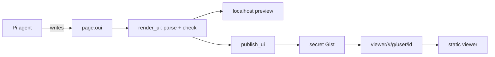

# pi-oui

Make web pages in [Pi](https://pi.dev/) and share them with a link, like
Claude artifacts.

The agent writes the page in
[OpenUI Lang](https://www.openui.com/docs/openui-lang). You check it in a local
preview. Then you publish it and get a link. Anyone with the link can open the
page in a browser. The reader needs no Pi, no account and no login.

A page can use only the components of the
[OpenUI](https://github.com/thesysdev/openui) library. It cannot contain HTML or
scripts, so a shared page cannot run code that a model wrote.

## How it works



The project has three parts:

1. **The Pi package.** It adds tools, commands and a skill to Pi. The agent
   uses them to write, check, preview and publish pages.
2. **The viewer.** A static React app on GitHub Pages. It renders pages with
   the OpenUI components. The local preview uses the same app.
3. **Storage.** A secret GitHub Gist on your `gh` account holds each published
   page. The link holds only your GitHub username and the Gist ID. It never
   holds the page.

There is no backend. We write no components and no CSS. OpenUI gives the
components, the themes and the prompt that teaches the model to use them.

For the tools, the commands, the settings and the security rules, see the
[package README](packages/pi/README.md).

## Status

Phase 1 is done: make, check, preview, publish and delete pages. The package
is not on npm yet, and the viewer is not on GitHub Pages yet.

The next phases are in the [design document](docs/design.md#phases):

1. Live data: `Query()` in the preview, and snapshots on publish.
2. Live preview while the agent writes the page.

## Repository layout

The repository is an npm workspace:

```text
packages/
  pi/        # the Pi package: tools, commands, skill, Gist client
  viewer/    # Vite + React app for GitHub Pages and the local preview
scripts/
  library.ts      # writes library.spec.json and reference.md into packages/pi
  copy-viewer.mjs # copies the viewer build into packages/pi/viewer
  size.mjs        # prints the size of each file in the viewer build
docs/
  design.md          # the design
  spike-phase-1.md   # what the phase 1 spike found
```

## Develop

You need Node 24 and npm.

`@openuidev/lang-core` sends telemetry from its `postinstall` script. npm 12
blocks this script. With older npm, turn the telemetry off before you install:

```fish
set -x OPENUI_TELEMETRY_DISABLED 1
npm install
```

Build, test and type check from the repository root:

```fish
npm run build   # library spec, skill reference, viewer
npm test
npm run check
```

Load the package in Pi without installing it:

```fish
pi -e packages/pi/src/index.ts --skill packages/pi/skills/openui-page
```

To try the viewer alone, run `npm run dev -w packages/viewer`.

## Deploy the viewer

The workflow in `.github/workflows/pages.yml` builds the viewer and deploys it
to GitHub Pages. It runs on each push to `master` that changes the viewer, and
you can also start it by hand.

1. In the repository settings, set the Pages source to GitHub Actions.
2. Push to `master`, or run the "Viewer" workflow.

Links point to `https://ssiyad.github.io/pi-oui/` by default. To use another
viewer, set `PI_UI_VIEWER_URL`.

## References

- [OpenUI Lang specification](https://www.openui.com/docs/openui-lang/specification)
- [OpenUI](https://github.com/thesysdev/openui)
- [Pi](https://pi.dev/)
- [pi-artifacts by jakeryderv](https://github.com/jakeryderv/pi-artifacts)
