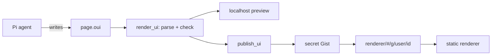

# Design: shareable OpenUI pages from Pi

Status: draft. Name: `pi-oui`. The renderer is at `https://ssiyad.github.io/pi-oui/`.

## Goal

A Pi user asks the agent for a page. The agent writes the page in
[OpenUI Lang](https://www.openui.com/docs/openui-lang). The user previews it
on localhost. Then the user publishes it and gets a link. Anyone with the link
can open the page in a browser. The reader of the page does not need Pi, an
account, or a login.

This is the model of Claude artifacts, with these differences:

- The agent writes OpenUI Lang, not HTML or JavaScript.
- Pages live in a secret GitHub Gist. The link holds only the Gist ID. We run
  no backend.
- The Pi package and the renderer are open source.

## Principle: we do no design

OpenUI provides the components, the styles, the themes and the prompt that
teaches the model to use them. We write no components and no CSS. Our code
moves pages between Pi, storage and the renderer. The one exception is the
renderer banner, which is a few lines of CSS on the OpenUI theme variables.

If a page needs a component that OpenUI does not have, the page does without
it. We do not add our own components.

## Why OpenUI Lang

A page in OpenUI Lang can only use components from the component library. It
has no raw HTML and no scripts. The renderer runs only OpenUI code, so a shared
page cannot run code that a model wrote. An HTML page needs a sandbox for the
same result.

A page is also small. OpenUI reports about 1,400 output tokens for each screen.

## Parts

The project has three parts:

1. **The Pi package.** Tools, commands and a skill. It runs in Node inside Pi.
2. **The renderer.** A static React app on GitHub Pages. It renders pages with
   the OpenUI component library.
3. **Storage.** A secret GitHub Gist holds each published page. Pi writes it,
   and the renderer reads it. The link holds only the Gist ID.



## OpenUI packages

| Package                 | Version | Used by           | For                                        |
| ----------------------- | ------- | ----------------- | ------------------------------------------ |
| `@openuidev/lang-core`  | 1.x     | Pi package        | Parse and check pages in Node.             |
| `@openuidev/react-lang` | 1.x     | renderer            | The `Renderer` component.                  |
| `@openuidev/react-ui`   | 0.18    | renderer, build     | `openuiLibrary`, its prompt and its themes. |

The renderer uses `openuiLibrary`, the full library. It has layout, text,
charts, tables, forms, images, tags and code blocks. `openuiChatLibrary` is a
smaller set for chat replies, so we do not use it.

We do not use `@openuidev/browser-bundle`. It contains only
`openuiChatLibrary`.

The Pi package and the renderer must read the same version of OpenUI Lang. If
they do not, `render_ui` can accept a page that the renderer cannot render. One
lockfile at the workspace root pins all OpenUI packages.

## Page format

A page is one text file, `page.oui`. It uses the OpenUI
[stored message format](https://www.openui.com/docs/openui-lang/message-protocol):

```text
]]>openui:content?library=openui%400.18.1
root = Stack([header, chart])
header = CardHeader("Q3 revenue")
chart = BarChart(...)
]]>openui:context
{"title":"Q3 revenue","created":"2026-10-31T10:00:00Z","data":{}}
]]>openui:end
```

- The `library` marker records the `react-ui` version. The renderer shows a
  warning when a page needs a newer version.
- The `context` section holds metadata and snapshot data. See
  [Live data](#live-data).

## Pi package

### Tools

| Tool             | What it does                                                         |
| ---------------- | -------------------------------------------------------------------- |
| `scaffold_ui`    | Make an empty page bundle and return the path of `page.oui`.          |
| `render_ui`      | Parse and check the page, then show it in the localhost preview.      |
| `publish_ui`     | Publish the page and return the link. Asks the user first.            |
| `unpublish_ui`   | Delete the Gist of a published page.                                  |
| `list_ui`        | List local pages and their published links.                           |
| `import_ui`      | Read a page from a link into a new local bundle, to remix it.         |

`render_ui` parses the page with `createParser()` from `lang-core`. It
returns each error to the agent, with the error code, the statement ID and the
hint. It skips errors with `severity: "warning"`. The agent fixes the page and
calls `render_ui` again. This is the same loop as a compiler error.

The parser checks only statements that `root` reaches. OpenUI drops the other
statements without an error. `render_ui` reports the names in
`meta.unresolved` and `meta.orphaned` as errors.

`render_ui` also reports these as errors:

- `no-root`. OpenUI makes it a warning and renders another statement. A
  shared page must say what its root is.
- `incomplete`: the page ends in the middle of a statement.
- `needs-tools`: a `Query()` or `Mutation()` statement. A shared page has no
  tools.
- `not-https`: an `@OpenUrl` link that is not `https:`. The renderer does not
  open it.

`@ToAssistant` is a warning, because the button does nothing in a shared page.

### Library files

The Pi package does not import React. At build time, a script reads
`openuiLibrary` from `react-ui` and writes two files into the Pi package:

- `library.spec.json`, from `openuiLibrary.toJSONSchema()`. `createParser()`
  reads it.
- `skills/openui-page/reference.md`, from
  `openuiLibrary.prompt(openuiPromptOptions)` with our own `preamble`. The
  skill links to it.

### Commands

| Command      | What it does                                      |
| ------------ | ------------------------------------------------- |
| `/ui [id]`   | Open a page in the localhost preview.             |
| `/share [id]`| Publish a page. Same as `publish_ui`.             |

Without an ID, both commands show a list of the pages.

### Skill

The skill teaches the agent the workflow and the rules of a shared page. It
links to `reference.md`, which OpenUI writes. `reference.md` is about 9,000
tokens. OpenUI's own preamble says that the whole response must be OpenUI
Lang. Our preamble says that this rule applies to `page.oui` only. The skill
loads only when the agent works on a page. Other turns do not pay for the
component reference.

### Preview

The first `render_ui` starts an HTTP server on `127.0.0.1` with a random
port. It serves the renderer build and `/pages/<id>/page.oui`. It refuses
requests with another `Host` header, so other sites cannot reach it through
DNS rebinding.

`render_ui` opens the browser only when no preview tab is open. Open tabs get a
`render` event on `/events` and reload the page.

### Storage

Local bundles live in `~/.pi/ui/<id>/`:

```text
manifest.json   # id, title, session, workspace, published links
page.oui
```

## Renderer

The renderer is a static single-page app built with Vite. It has one job: get
the page text and pass it to `<Renderer library={openuiLibrary} />`.

The localhost preview in Pi serves the same build. The preview and the shared
page look the same.

### Theme

The renderer wraps the page in `ThemeProvider` from `react-ui`. It uses
`defaultLightTheme` and `defaultDarkTheme` and follows the
`prefers-color-scheme` setting of the browser. We do not change the themes.

`ThemeProvider` sets its variables on `body` but does not paint the page. The
renderer's CSS sets the `body` background, text color and font from these
variables. The banner uses the same variables, so it follows the theme.

### Routes

GitHub Pages cannot route paths in a single-page app. All routes are in the
URL fragment:

| Route                         | Source                                        |
| ----------------------------- | --------------------------------------------- |
| `#/g/<user>/<gist-id>`        | The page is in a secret Gist.                 |
| `#/l/<id>`                    | A local page on the preview server.           |

### Features

Phase 1:

- Render the page and set the title.
- Show a full-width banner above the page. For a shared page, it shows the
  owner's GitHub ID with a link to the profile, says "User-generated
  content", and says "Rendered using pi-oui" with a link to
  <https://github.com/ssiyad/pi-oui>. It does not say where the page is
  stored. For a local page, it says that only the user can see it.
- Check the page with the same `PageChecker` as `render_ui`. If the page has
  problems, an OpenUI `Callout` lists them above the page. OpenUI drops broken
  statements without an error, and an author without Pi has no other way to
  see why.

`PageChecker` imports no Node modules, so the renderer imports it from the Pi
package. Pi reads the library spec from a file, and the renderer gets it from
`openuiLibrary`.

Anyone can open their own Gist in the renderer. The Gist needs a `page.oui`
file in OpenUI Lang. Pi does not need to make it.

Later:

- Copy a remix command: `pi "remix <link>"`.
- Download the page as one HTML file.
- Print.

### Size

The first load is about 770 KB gzipped: a 730 KB script and a 38 KB
stylesheet.
KaTeX and icons load only when a page uses them. This is the cost of no design
work. The browser caches the renderer, so a second page opens fast.

The syntax highlighter of `CodeBlock` is 31% of the script, because it
contains all Prism languages. See [the spike](spike-phase-1.md).

### Old pages

A new `react-ui` version can change or remove components. When a version
breaks old pages, we keep the old renderer build at `/v/<version>/`. The renderer
reads the `library` marker and loads the matching build.

## Storage

A link never holds the page. A page in the link would go everywhere that
the link goes: chat history, browser history, link previews and logs. Nobody
could delete it, and long links break in chat apps. So every published page
goes into a secret Gist, and the link holds only the Gist ID. GitHub makes the
Gist ID from 128 random bits, which is more than a UUID v4. The link also
holds the GitHub username, because the raw URL returns 404 without the
correct owner.

1. Run `gh gist create` with `page.oui`. Gists are secret by default.
2. Return `#/g/<user>/<gist-id>`.

The renderer reads
`https://gist.githubusercontent.com/<user>/<gist-id>/raw/page.oui`. This
endpoint sends `Access-Control-Allow-Origin: *` and does not have the API
rate limit. It caches for 300 seconds, so an update can take 5 minutes to
show. The GitHub API (`api.github.com/gists`) allows 60 requests an hour for
each IP without a login, so the renderer does not use it.

To update a page, `publish_ui` edits the same Gist. To delete a page,
`unpublish_ui` deletes the Gist.

We tested this route with a real secret Gist on 2026-10-31. Create, edit and
delete through `gh` work, and the renderer shows the page from the raw URL
with no console errors. The raw URL is slow to change:

- After an edit, the raw URL sends the old version for up to 5 minutes.
- After a delete, the raw URL sends the old page for about 5 to 6 minutes,
  then 404. The renderer then shows "Cannot load the page (HTTP 404)".
- A query string does not get a new copy. The response says
  `x-cache: MISS` and still has the old page, so the cache is behind the CDN.

`publish_ui` and `unpublish_ui` tell the user about this delay.

A secret Gist is not private. Anyone with the link can read it.

To publish, the user needs the GitHub CLI with a login that has the `gist`
scope.

## Live data

`Query()` in OpenUI Lang calls a tool through a `toolProvider`. A reader of a
shared page has no Pi and no tools. Shared pages must not call tools.

Instead, `publish_ui` takes a snapshot:

1. Run each `Query()` in Node with `createQueryManager()`, with Pi tools as
   the `toolProvider`.
2. Replace each `Query()` statement with its result as a literal value.
3. Remove all `Mutation()` statements and the buttons that run them.

The user builds a page with live data in the preview and shares a snapshot.
Phase 1 has no `Query()` support. Phase 2 adds it.

## Security and privacy

### For people who open a page

- The renderer passes no `toolProvider` to the OpenUI `Renderer` component.
- `@ToAssistant` does nothing in the renderer.
- `@OpenUrl` accepts only `https:` links. The renderer shows the target and asks
  before it opens the link. Links in Markdown go through the same check: a
  click listener on the window catches each click on a link before the
  components get it. It guards all links except the banner links, because a
  `Modal` renders outside the page area. Links that are not `https:` show a
  message and do not open.
- The listener cannot stop the browser's own link menu. "Open in new tab"
  from the context menu, and dragging a link to the tab bar, open the link
  without a confirm. The reader starts these actions and sees the URL first.
- The banner shows the GitHub user who made a shared page. A page cannot hide
  the banner, so readers know that a user made the page. When the
  route changes, the renderer clears the old page before it loads the new one.
- The route accepts only the characters of GitHub user names and hex Gist IDs.
- The renderer stops reading a page at 2 MB, so a large page does not freeze
  the tab.
- Markdown renders with `react-markdown` and no `rehype-raw`. Raw HTML in a
  page does not render. `react-markdown` also removes `javascript:` links.
- The renderer sets a Content Security Policy: no inline scripts, and
  `connect-src` limited to `gist.githubusercontent.com`.
- Image components load images from any `https:` host. That host sees the IP
  address of the person who opens the page. `publish_ui` lists the image hosts
  before it publishes.

### For the person who shares a page

Publishing sends content to a public place. `publish_ui` always:

1. Shows the title, the Gist it creates or updates, the size and the image
   hosts of the page.
2. Scans the page for secrets: API keys, tokens, private keys, passwords.
3. Asks the user to confirm in the TUI.

`lang-core` sends pseudonymous telemetry from its `postinstall` script. npm 12
blocks this script by default. Older npm versions run it, and our package
cannot stop it. The README tells users to set `OPENUI_TELEMETRY_DISABLED=1`
before they install. Runtime telemetry is off unless the user turns it on.

## Repository layout

The repository is an npm workspace:

```text
packages/
  renderer/    # Vite + React app for GitHub Pages and the localhost preview
  pi/        # the Pi package: tools, commands, skill, Gist client
scripts/
  library.ts      # writes library.spec.json and reference.md into packages/pi
  copy-renderer.mjs # copies the renderer build into packages/pi/renderer
```

`npm run build` runs both scripts and builds the renderer. A GitHub Actions
workflow deploys `packages/renderer/dist` to GitHub Pages.

## Phases

1. **Share a page.** `scaffold_ui`, `render_ui`, `publish_ui` to a secret
   Gist, `unpublish_ui`, `list_ui`. The renderer on GitHub Pages.
2. **Live data.** `Query()` in the preview, and snapshots on publish.
   `import_ui` and remix.
3. **Live preview while the agent writes.** Render the page from the
   `message_update` events, before the tool call ends.

## Open questions

- Can `createQueryManager()` run in Node with Pi tools as the provider?
- Do `message_update` events contain partial tool call arguments?

## References

- [OpenUI Lang specification](https://www.openui.com/docs/openui-lang/specification)
- [`@openuidev/lang-core`](https://github.com/thesysdev/openui/tree/main/packages/lang-core)
- [`@openuidev/react-ui`](https://github.com/thesysdev/openui/tree/main/packages/react-ui)
- [pi-artifacts by jakeryderv](https://github.com/jakeryderv/pi-artifacts)
- [Pi extensions](https://pi.dev/)
