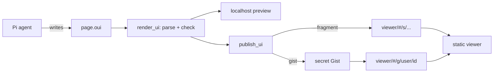

# Design: shareable OpenUI pages from Pi

Status: draft. Working name: `pi-artifacts`. The npm name is not decided.

## Goal

A Pi user asks the agent for a page. The agent writes the page in
[OpenUI Lang](https://www.openui.com/docs/openui-lang). The user previews it
on localhost. Then the user publishes it and gets a link. Anyone with the link
can open the page in a browser. The viewer of the page does not need Pi, an
account, or a login.

This is the model of Claude artifacts, with these differences:

- The agent writes OpenUI Lang, not HTML or JavaScript.
- Pages live in the link itself or in a secret GitHub Gist. We run no backend.
- The Pi package and the viewer are open source.

## Principle: we do no design

OpenUI provides the components, the styles, the themes and the prompt that
teaches the model to use them. We write no components and no CSS. Our code
moves pages between Pi, storage and the viewer.

If a page needs a component that OpenUI does not have, the page does without
it. We do not add our own components.

## Why OpenUI Lang

A page in OpenUI Lang can only use components from the component library. It
has no raw HTML and no scripts. The viewer runs only OpenUI code, so a shared
page cannot run code that a model wrote. An HTML page needs a sandbox for the
same result.

A page is also small. OpenUI reports about 1,400 output tokens for each screen.
After compression, most pages fit in a URL.

## Parts

The project has three parts:

1. **The Pi package.** Tools, commands and a skill. It runs in Node inside Pi.
2. **The viewer.** A static React app on GitHub Pages. It renders pages with
   the OpenUI component library.
3. **Storage adapters.** Code that writes a page to a link (in Pi) and reads it
   back (in the viewer). Version 1 has two adapters: `fragment` and `gist`.



## OpenUI packages

| Package                 | Version | Used by           | For                                        |
| ----------------------- | ------- | ----------------- | ------------------------------------------ |
| `@openuidev/lang-core`  | 1.x     | Pi package        | Parse and check pages in Node.             |
| `@openuidev/react-lang` | 1.x     | viewer            | The `Renderer` component.                  |
| `@openuidev/react-ui`   | 0.18    | viewer, build     | `openuiLibrary`, its prompt and its themes. |

The viewer uses `openuiLibrary`, the full library. It has layout, text,
charts, tables, forms, images, tags and code blocks. `openuiChatLibrary` is a
smaller set for chat replies, so we do not use it.

We do not use `@openuidev/browser-bundle`. It contains only
`openuiChatLibrary`.

The Pi package and the viewer must read the same version of OpenUI Lang. If
they do not, `render_ui` can accept a page that the viewer cannot render. One
lockfile at the workspace root pins all OpenUI packages.

## Page format

A page is one text file, `page.oui`. It uses the OpenUI
[stored message format](https://www.openui.com/docs/openui-lang/message-protocol):

```text
]]>openui:content?library=openui%400.18.1
root = Stack([header, chart])
header = CardHeader("Q3 revenue")
chart = BarChart(...)
]]>openui:context
{"title":"Q3 revenue","created":"2026-10-31T10:00:00Z","data":{}}
]]>openui:end
```

- The `library` marker records the `react-ui` version. The viewer shows a
  warning when a page needs a newer version.
- The `context` section holds metadata and snapshot data. See
  [Live data](#live-data).

## Pi package

### Tools

| Tool             | What it does                                                         |
| ---------------- | -------------------------------------------------------------------- |
| `scaffold_ui`    | Make an empty page bundle and return the path of `page.oui`.          |
| `render_ui`      | Parse and check the page, then show it in the localhost preview.      |
| `publish_ui`     | Publish the page and return the link. Asks the user first.            |
| `unpublish_ui`   | Delete the Gist of a published page.                                  |
| `list_ui`        | List local pages and their published links.                           |
| `import_ui`      | Read a page from a link into a new local bundle, to remix it.         |

`render_ui` parses the page with `createParser()` from `lang-core`. It
returns each error to the agent, with the error code, the statement ID and the
hint. It skips errors with `severity: "warning"`. The agent fixes the page and
calls `render_ui` again. This is the same loop as a compiler error.

### Library files

The Pi package does not import React. At build time, a script reads
`openuiLibrary` from `react-ui` and writes two files into the Pi package:

- `library.spec.json`, from `openuiLibrary.toJSONSchema()`. `createParser()`
  reads it.
- `prompt.md`, from `openuiLibrary.prompt(openuiPromptOptions)`. The skill
  includes it.

### Commands

| Command      | What it does                                      |
| ------------ | ------------------------------------------------- |
| `/ui`        | Open the localhost gallery of local pages.        |
| `/share`     | Publish the current page. Same as `publish_ui`.   |

### Skill

The skill teaches the agent the workflow. It includes `prompt.md`, which
OpenUI writes. The skill loads only when the agent works on a page. Other
turns do not pay for the component reference.

### Storage

Local bundles live in `~/.pi/ui/<id>/`:

```text
manifest.json   # id, title, session, workspace, published links
page.oui
```

## Viewer

The viewer is a static single-page app built with Vite. It has one job: get
the page text and pass it to `<Renderer library={openuiLibrary} />`.

The localhost preview in Pi serves the same build. The preview and the shared
page look the same.

### Theme

The viewer wraps the page in `ThemeProvider` from `react-ui`. It uses
`defaultLightTheme` and `defaultDarkTheme` and follows the
`prefers-color-scheme` setting of the browser. We do not change the themes.

### Routes

GitHub Pages cannot route paths in a single-page app. All routes are in the
URL fragment:

| Route                         | Source                                        |
| ----------------------------- | --------------------------------------------- |
| `#/s/<version>.<payload>`     | The page is in the fragment.                  |
| `#/g/<user>/<gist-id>`        | The page is in a secret Gist.                 |

### Features

- Render the page.
- Show the source.
- Copy a remix command: `pi "remix <link>"`.
- Download the page as one HTML file.
- Print.

### Size

`react-ui` includes Radix, d3, KaTeX and a syntax highlighter. The prebuilt
OpenUI bundle is about 900 KB gzipped, and the viewer will be close to that.
This is the cost of no design work. The browser caches the viewer, so a
second page opens fast.

### Old pages

A new `react-ui` version can change or remove components. When a version
breaks old pages, we keep the old viewer build at `/v/<version>/`. The viewer
reads the `library` marker and loads the matching build.

## Storage adapters

### `fragment`

1. Compress `page.oui` with raw deflate.
2. Encode the result as base64url.
3. Put it in the fragment: `#/s/1.<payload>`.

The viewer reverses this with `DecompressionStream("deflate-raw")`.

Browsers do not send the fragment to the server. GitHub Pages never sees the
page. A link cannot be changed or deleted, because the link is the page.

### `gist`

1. Run `gh gist create` with `page.oui`. Gists are secret by default.
2. Return `#/g/<user>/<gist-id>`.

The viewer reads
`https://gist.githubusercontent.com/<user>/<gist-id>/raw/page.oui`. This
endpoint sends `Access-Control-Allow-Origin: *` and does not have the API
rate limit. It caches for 300 seconds, so an update can take 5 minutes to
show. The GitHub API (`api.github.com/gists`) allows 60 requests an hour for
each IP without a login, so the viewer does not use it.

To update a page, `publish_ui` edits the same Gist. To delete a page,
`unpublish_ui` deletes the Gist.

A secret Gist is not private. Anyone with the link can read it.

### Which adapter

- If the fragment link is 8 KB or less, use `fragment`.
- If the link is longer than 8 KB, use `gist`.
- If the user asks for a link that can be updated or deleted, use `gist`.

The 8 KB limit is a guess. Some chat apps cut long links. We test it in phase 1.

## Live data

`Query()` in OpenUI Lang calls a tool through a `toolProvider`. A viewer of a
shared page has no Pi and no tools. Shared pages must not call tools.

Instead, `publish_ui` takes a snapshot:

1. Run each `Query()` in Node with `createQueryManager()`, with Pi tools as
   the `toolProvider`.
2. Replace each `Query()` statement with its result as a literal value.
3. Remove all `Mutation()` statements and the buttons that run them.

The user builds a page with live data in the preview and shares a snapshot.
Phase 1 has no `Query()` support. Phase 2 adds it.

## Security and privacy

### For people who open a page

- The viewer passes no `toolProvider` to the renderer.
- `@ToAssistant` does nothing in the viewer.
- `@OpenUrl` accepts only `https:` links. The viewer shows the target and asks
  before it opens the link.
- Markdown renders with `react-markdown` and no `rehype-raw`. Raw HTML in a
  page does not render. `react-markdown` also removes `javascript:` links.
- The viewer sets a Content Security Policy: no inline scripts, and
  `connect-src` limited to `gist.githubusercontent.com`.
- Image components load images from any `https:` host. That host sees the IP
  address of the person who opens the page. `publish_ui` lists the image hosts
  before it publishes.

### For the person who shares a page

Publishing sends content to a public place. `publish_ui` always:

1. Shows the title, the adapter, the size and the image hosts of the page.
2. Scans the page for secrets: API keys, tokens, private keys, passwords.
3. Asks the user to confirm in the TUI.

`lang-core` sends pseudonymous telemetry from its `postinstall` script. Our
package cannot stop this script. The README tells users to set
`OPENUI_TELEMETRY_DISABLED=1` before they install. Runtime telemetry is off
unless the user turns it on.

## Repository layout

The repository is an npm workspace:

```text
packages/
  viewer/    # Vite + React app for GitHub Pages and the localhost preview
  pi/        # the Pi package: tools, commands, skill, adapters
scripts/
  library.ts # writes library.spec.json and prompt.md into packages/pi
```

## Phases

1. **Share a page.** `scaffold_ui`, `render_ui`, `publish_ui` with
   `fragment` and `gist`, `unpublish_ui`, `list_ui`. The viewer on GitHub
   Pages.
2. **Live data.** `Query()` in the preview, and snapshots on publish.
   `import_ui` and remix.
3. **Live preview while the agent writes.** Render the page from the
   `message_update` events, before the tool call ends.

## Open questions

- The npm name and the viewer domain.
- Can the build script import `openuiLibrary` in Node, or does it need a
  browser environment?
- Can `createQueryManager()` run in Node with Pi tools as the provider?
- What is the gzip size of the viewer?
- What link length do Slack, WhatsApp and Raven accept?
- Do `message_update` events contain partial tool call arguments?

## References

- [OpenUI Lang specification](https://www.openui.com/docs/openui-lang/specification)
- [`@openuidev/lang-core`](https://github.com/thesysdev/openui/tree/main/packages/lang-core)
- [`@openuidev/react-ui`](https://github.com/thesysdev/openui/tree/main/packages/react-ui)
- [pi-artifacts by jakeryderv](https://github.com/jakeryderv/pi-artifacts)
- [Pi extensions](https://pi.dev/)
