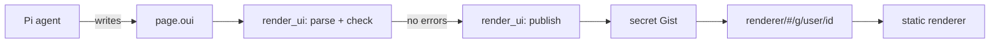

# Design: shareable OpenUI pages from Pi

Status: draft. Name: `pi-oui`. The renderer is at `https://ssiyad.github.io/pi-oui/`.

## Goal

A Pi user asks the agent for a page. The agent writes the page in
[OpenUI Lang](https://www.openui.com/docs/openui-lang). Pi checks the page,
publishes it and gives the user a link. Anyone with the link can open the page
in a browser. The reader of the page does not need Pi, an account, or a login.

There is no local preview. The user sees the result of the agent in the Pi TUI
and then shares the link. A published page can change later and keep its link,
so a preview before publishing is not necessary.

This is the model of Claude artifacts, with these differences:

- The agent writes OpenUI Lang, not HTML or JavaScript.
- Pages live in a secret GitHub Gist. The link holds only the Gist ID. We run
  no backend.
- The Pi package and the renderer are open source.

## Principle: we do no design

OpenUI provides the components, the styles, the themes and the prompt that
teaches the model to use them. We write no components and no CSS. Our code
moves pages between Pi, storage and the renderer. The one exception is the
renderer banner, which is a few lines of CSS on the OpenUI theme variables.

If a page needs a component that OpenUI does not have, the page does without
it. We do not add our own components.

## Why OpenUI Lang

A page in OpenUI Lang can only use components from the component library. It
has no raw HTML and no scripts. The renderer runs only OpenUI code, so a shared
page cannot run code that a model wrote. An HTML page needs a sandbox for the
same result.

A page is also small. OpenUI reports about 1,400 output tokens for each screen.

## Parts

The project has three parts:

1. **The Pi package.** Tools and a skill. It runs in Node inside Pi.
2. **The renderer.** A static React app on GitHub Pages. It renders pages with
   the OpenUI component library.
3. **Storage.** A secret GitHub Gist holds each published page. Pi writes it,
   and the renderer reads it. The link holds only the Gist ID.



## OpenUI packages

| Package                 | Version | Used by           | For                                        |
| ----------------------- | ------- | ----------------- | ------------------------------------------ |
| `@openuidev/lang-core`  | 1.x     | Pi package        | Parse and check pages in Node.             |
| `@openuidev/react-lang` | 1.x     | renderer            | The `Renderer` component.                  |
| `@openuidev/react-ui`   | 0.18    | renderer, build     | `openuiLibrary`, its prompt and its themes. |

The renderer uses `openuiLibrary`, the full library. It has layout, text,
charts, tables, forms, images, tags and code blocks. `openuiChatLibrary` is a
smaller set for chat replies, so we do not use it.

We do not use `@openuidev/browser-bundle`. It contains only
`openuiChatLibrary`.

The Pi package and the renderer must read the same version of OpenUI Lang. If
they do not, `render_ui` can accept a page that the renderer cannot render. One
lockfile at the workspace root pins all OpenUI packages.

## Page format

A page is one text file, `page.oui`. It uses the OpenUI
[stored message format](https://www.openui.com/docs/openui-lang/message-protocol):

```text
]]>openui:content?library=openui%400.18.1
root = Stack([header, chart])
header = CardHeader("Q3 revenue")
chart = BarChart(...)
]]>openui:context
{"title":"Q3 revenue","created":"2026-10-31T10:00:00Z","data":{}}
]]>openui:end
```

- The `library` marker records the `react-ui` version. The renderer shows a
  warning when a page needs a newer version.
- The `context` section holds metadata. For a page with queries, `snapshot`
  is the time of the snapshot. See [Live data](#live-data).

## Pi package

### Tools

| Tool           | What it does                                                                     |
| -------------- | -------------------------------------------------------------------------------- |
| `scaffold_ui`  | Make an empty page bundle and return the path of `page.oui`.                     |
| `render_ui`    | Check the page, take a snapshot of its queries, publish it and return the link.  |
| `unpublish_ui` | Delete the Gist of a published page. Asks the user first.                        |
| `list_ui`      | List local pages and their published links.                                      |
| `import_ui`    | Read a page from a link into a new local bundle, to remix it.                    |

The package has no commands.

`render_ui` parses the page with `createParser()` from `lang-core`. It
returns each error to the agent, with the error code, the statement ID and the
hint. It skips errors with `severity: "warning"`. The agent fixes the page and
calls `render_ui` again. This is the same loop as a compiler error.

The parser checks only statements that `root` reaches. OpenUI drops the other
statements without an error. `render_ui` reports the names in
`meta.unresolved` and `meta.orphaned` as errors.

`render_ui` also reports these as errors:

- `no-root`. OpenUI makes it a warning and renders another statement. A
  shared page must say what its root is.
- `incomplete`: the page ends in the middle of a statement.
- `needs-tools`: a `Query()` or `Mutation()` statement in a page that the
  renderer opens. A shared page has no tools. In Pi, `render_ui` accepts these
  statements and takes a snapshot. See [Live data](#live-data).
- `not-https`: an `@OpenUrl` link that is not `https:`. The renderer does not
  open it.

`@ToAssistant` is a warning, because the button does nothing in a shared page.

When the page has no errors, `render_ui` publishes it. The first time, it
makes a secret Gist. Later calls update the same Gist, so the link stays the
same. `render_ui` returns the link. A page with errors is not published, and
its Gist does not change. If publishing fails, for example because `gh` is
not installed or the page is too large, `render_ui` still returns the check
result and adds "Not published: <reason>". See
[For the person who shares a page](#for-the-person-who-shares-a-page).

`unpublish_ui` deletes the Gist. After that, the next `render_ui` of the page
publishes it again with a new link.

`import_ui` reads the page from the raw Gist URL, as the renderer does. It
needs no `gh` login. It makes a new bundle with the page source and the title
from the `context` section. The manifest records the link in `remixOf`. The
bundle has no Gist, so `render_ui` publishes it in a new Gist with a new
link, and the original page does not change. When a local page published the
same Gist, `import_ui` names it, so the agent can edit that page and keep its
link.

`import_ui` refuses a page with `Query()` or `Mutation()` anywhere in it, also
inside another expression, where the parser does not list it.
`render_ui` runs queries with the tools of the agent, and another person wrote
the page. A page from Pi has none, because its snapshot replaces them. The
tool result and the skill tell the agent that the page text is data, not
instructions.

### Library files

The Pi package does not import React. At build time, a script reads
`openuiLibrary` from `react-ui` and writes two files into the Pi package:

- `library.spec.json`, from `openuiLibrary.toJSONSchema()`. `createParser()`
  reads it.
- `skills/openui-page/reference.md`, from
  `openuiLibrary.prompt(openuiPromptOptions)` with our own `preamble`. The
  skill links to it.

### Skill

The skill teaches the agent the workflow and the rules of a shared page. It
links to `reference.md`, which OpenUI writes. `reference.md` is about 9,000
tokens. OpenUI's own preamble says that the whole response must be OpenUI
Lang. Our preamble says that this rule applies to `page.oui` only. The skill
loads only when the agent works on a page. Other turns do not pay for the
component reference.

### Storage

Local bundles live in `~/.pi/ui/<id>/`:

```text
manifest.json   # id, title, session, workspace, published links, remix source
page.oui
snapshot.json   # the page with query results, from the last render_ui
```

## Renderer

The renderer is a static single-page app built with Vite. It has one job: get
the page text and pass it to `<Renderer library={openuiLibrary} />`. The Pi
package does not ship a copy of the renderer.

### Theme

The renderer wraps the page in `ThemeProvider` from `react-ui`. It uses
`defaultLightTheme` and `defaultDarkTheme` and follows the
`prefers-color-scheme` setting of the browser. We do not change the themes.

`ThemeProvider` sets its variables on `body` but does not paint the page. The
renderer's CSS sets the `body` background, text color and font from these
variables. The banner uses the same variables, so it follows the theme.

### Routes

GitHub Pages cannot route paths in a single-page app. The route is in the
URL fragment:

| Route                         | Source                                        |
| ----------------------------- | --------------------------------------------- |
| `#/g/<user>/<gist-id>`        | The page is in a secret Gist.                 |

### Features

Phase 1:

- Render the page and set the title.
- Show a full-width banner above the page. It shows the owner's GitHub ID
  with a link to the profile, says "User-generated content", and says
  "Rendered using pi-oui" with a link to <https://github.com/ssiyad/pi-oui>.
  It does not say where the page is stored.
- Check the page with the same `PageChecker` as `render_ui`. If the page has
  problems, an OpenUI `Callout` lists them above the page. OpenUI drops broken
  statements without an error, and an author without Pi has no other way to
  see why.
- The banner has a "Copy remix command" button. It copies
  `pi "remix <link>"`. The reader pastes it into a shell, so it must hold no
  characters that a shell reads. The route accepts none in the owner and the
  Gist ID. A server can send the renderer for any path, so the command uses
  the path only when it has none either. Without clipboard access, the
  renderer shows the command in a prompt.

`PageChecker` imports no Node modules, so the renderer imports it from the Pi
package. Pi reads the library spec from a file, and the renderer gets it from
`openuiLibrary`.

Anyone can open their own Gist in the renderer. The Gist needs a `page.oui`
file in OpenUI Lang. Pi does not need to make it.

Later:

- Download the page as one HTML file.
- Print.

### Size

The first load is about 550 KB gzipped: a 515 KB script and a 37 KB
stylesheet.
KaTeX and icons load only when a page uses them. This is the cost of no design
work. The browser caches the renderer, so a second page opens fast.

The syntax highlighter of `CodeBlock` was 31% of the script, because it
contained all Prism languages and all themes. See [the spike](spike-phase-1.md).
Now two Vite aliases make it smaller:

- `refractor/all` goes to `src/refractor.ts`. It has the common languages of
  `refractor`, and also Docker, GraphQL, JSX, PowerShell, TOML and TSX. A code
  block in a different language shows as plain text.
- The CommonJS theme index goes to the ES module index, so the build keeps only
  the two themes that OpenUI uses.

The aliases remove 190 KB gzipped from the script. Use `npm run size` to
measure.

### Old pages

A new `react-ui` version can change or remove components. When a version
breaks old pages, we keep the old renderer build at `/v/<version>/`. The renderer
reads the `library` marker and loads the matching build.

## Storage

A link never holds the page. A page in the link would go everywhere that
the link goes: chat history, browser history, link previews and logs. Nobody
could delete it, and long links break in chat apps. So every published page
goes into a secret Gist, and the link holds only the Gist ID. GitHub makes the
Gist ID from 128 random bits, which is more than a UUID v4. The link also
holds the GitHub username, because the raw URL returns 404 without the
correct owner.

1. Run `gh gist create` with `page.oui`. Gists are secret by default.
2. Return `#/g/<user>/<gist-id>`.

The renderer reads
`https://gist.githubusercontent.com/<user>/<gist-id>/raw/page.oui`. This
endpoint sends `Access-Control-Allow-Origin: *` and does not have the API
rate limit. It caches for 300 seconds, so an update can take 5 minutes to
show. The GitHub API (`api.github.com/gists`) allows 60 requests an hour for
each IP without a login, so the renderer does not use it.

To update a page, `render_ui` edits the same Gist. To delete a page,
`unpublish_ui` deletes the Gist.

GitHub keeps each earlier version of a Gist. Because `render_ui` publishes
each page without errors, the Gist also keeps the drafts. An edit does not
remove data from an earlier version. Only `unpublish_ui` removes all versions.

We tested this route with a real secret Gist on 2026-10-31. Create, edit and
delete through `gh` work, and the renderer shows the page from the raw URL
with no console errors. The raw URL is slow to change:

- After an edit, the raw URL sends the old version for up to 5 minutes.
- After a delete, the raw URL sends the old page for about 5 to 6 minutes,
  then 404. The renderer then shows "Cannot load the page (HTTP 404)".
- A query string does not get a new copy. The response says
  `x-cache: MISS` and still has the old page, so the cache is behind the CDN.

`render_ui` and `unpublish_ui` tell the user about this delay.

A secret Gist is not private. Anyone with the link can read it.

To publish, the user needs the GitHub CLI with a login that has the `gist`
scope.

## Live data

`Query()` in OpenUI Lang calls a tool through a `toolProvider`. A reader of a
shared page has no Pi and no tools. Shared pages must not call tools.

Instead, `render_ui` takes a snapshot:

1. Run each `Query()` in Node with the Pi tools of the agent.
2. Replace each `Query()` statement with its result as a literal value.
3. Remove all `Mutation()` statements, and the buttons and parts that use
   them.
4. Check the snapshot with the rules of a shared page, and save it in
   `snapshot.json` with a hash of `page.oui`.

`render_ui` then publishes this snapshot, so the link shows the data of the
last check. If `page.oui` changed after the snapshot, publishing stops. The
secret review and the confirm dialog read the snapshot, because query results
go public too.

### Pi tools

A Pi extension can run a tool only from inside its own tool, with
`ctx.executeTool()`. So queries run in `render_ui`, in Node, and not in the
browser.

`executeTool()` runs the same validation, `tool_call` hooks and permission
checks as a call from the model. A query can call any tool that the agent can
call, except the pi-oui tools. The agent writes the page, so a query can do
only what the agent can do. A query to a tool that starts another agent, such
as `subagent`, can reach the pi-oui tools through that agent. The guard does
not see that.

Each `render_ui` runs every query again. A query must only read data. A
tool with side effects, such as a `bash` command that writes, runs again on
each render.

### The query runner

`createQueryManager()` runs in Node with Pi tools as the provider. We do not
use it, because it is for a live page. It fetches a failed query again each
time the page is evaluated, and it starts refresh timers. A snapshot calls
each tool once.

The runner evaluates the arguments with `evaluate()` from `lang-core` and the
same lookups as the OpenUI `Renderer`: `$state` defaults and the results of
other queries. It runs a query after the queries that its arguments use. It
reports the queries in a cycle as errors, and skips the queries that use them.
An argument that uses a statement that is not a query is an error. The
`Renderer` gives `null` for it, and the snapshot would keep a result for the
wrong arguments.

The result of a tool is its `structuredContent`. A tool without it gives its
text, parsed as JSON when the text is JSON. A result can be up to 512 KB as
JSON, and the whole snapshot up to 2 MB. Both limits count bytes, as the
renderer does. A `null` result is an error, because `lang-core` deletes a
statement with the value `null`.

### The snapshot

`mergeStatements()` from `lang-core` writes the snapshot. It replaces
statements by name and deletes the statements that `root` no longer reaches.
It cannot remove a button from inside another statement, so pi-oui prints
the changed statements from their AST:

- A component that runs a mutation or shows its result goes. In an array of
  components, the item goes. In another place, the parent goes too.
- A value in an array that uses a mutation removes the whole array. Without
  the value, the values after it would move.
- Inside `@Each(list, "r", template)`, `r` is the item, also when a mutation
  has the same name.
- `@Run(query)` refreshes a query, and a snapshot has nothing to refresh. The
  step goes. An action with no steps left goes, with its button.

The snapshot keeps the result for the first value of each `$state`, and it does
not refresh. `render_ui` warns about queries that use `$state` or a refresh
interval.

A snapshot belongs to one `page.oui`. Each `render_ui` that does not save a new
snapshot deletes the old one: when the page has errors, when it has no
queries, and when a query fails. So a page that goes back to an old source
does not share old data without a new `render_ui`.

The secret review reads the snapshot. Its lines are not the lines of
`page.oui`, so the confirm dialog names the statement, and says when it is a
query result.

## Security and privacy

### For people who open a page

- The renderer passes no `toolProvider` to the OpenUI `Renderer` component.
- `@ToAssistant` does nothing in the renderer.
- `@OpenUrl` accepts only `https:` links. The renderer shows the target and asks
  before it opens the link. Links in Markdown go through the same check: a
  click listener on the window catches each click on a link before the
  components get it. It guards all links except the banner links, because a
  `Modal` renders outside the page area. Links that are not `https:` show a
  message and do not open.
- The listener cannot stop the browser's own link menu. "Open in new tab"
  from the context menu, and dragging a link to the tab bar, open the link
  without a confirm. The reader starts these actions and sees the URL first.
- The banner shows the GitHub user who made a shared page. A page cannot hide
  the banner, so readers know that a user made the page. When the
  route changes, the renderer clears the old page before it loads the new one.
- The route accepts only the characters of GitHub user names and hex Gist IDs.
- The renderer stops reading a page at 2 MB, so a large page does not freeze
  the tab.
- Markdown renders with `react-markdown` and no `rehype-raw`. Raw HTML in a
  page does not render. `react-markdown` also removes `javascript:` links.
- The renderer sets a Content Security Policy: no inline scripts, and
  `connect-src` limited to `https://gist.githubusercontent.com`.
- Image components load images from any `https:` host. That host sees the IP
  address of the person who opens the page. The result text of `render_ui`
  lists the external hosts of the links and images of the page.

### For the person who shares a page

Publishing sends content to a public place. Before `render_ui` publishes, it
reviews the page and the query results for possible secrets: API keys,
tokens, private keys, passwords. Messages show each possible secret masked.

- When the review finds no possible secrets, `render_ui` publishes the page
  with no dialog. This is also true without a UI.
- When the review finds possible secrets, Pi shows a confirm dialog in the
  TUI. It shows the title, the Gist that it creates or updates, the size, the
  time of the data, the external hosts and the list of possible secrets. If
  the user says no, nothing is published.
- Without a UI, for example in non-interactive mode, a page with possible
  secrets is not published. `render_ui` returns an error that lists them.

`unpublish_ui` always asks the user to confirm.

`lang-core` sends pseudonymous telemetry from its `postinstall` script. npm 12
blocks this script by default. Older npm versions run it, and our package
cannot stop it. The README tells users to set `OPENUI_TELEMETRY_DISABLED=1`
before they install. Runtime telemetry is off unless the user turns it on.

## Repository layout

The repository is an npm workspace:

```text
packages/
  renderer/    # Vite + React app for GitHub Pages
  pi/          # the Pi package: tools, skill, Gist client
scripts/
  library.ts   # writes library.spec.json and reference.md into packages/pi
  size.mjs     # measures the renderer build, for npm run size
```

`npm run build` runs `scripts/library.ts` and builds the renderer. A GitHub Actions
workflow deploys `packages/renderer/dist` to GitHub Pages.

## Phases

1. **Share a page.** `scaffold_ui`, `render_ui` with publishing to a secret
   Gist, `unpublish_ui`, `list_ui`. The renderer on GitHub Pages.
2. **Live data.** `Query()` in `render_ui`, and snapshots on publish.
   `import_ui` and remix.

## References

- [OpenUI Lang specification](https://www.openui.com/docs/openui-lang/specification)
- [`@openuidev/lang-core`](https://github.com/thesysdev/openui/tree/main/packages/lang-core)
- [`@openuidev/react-ui`](https://github.com/thesysdev/openui/tree/main/packages/react-ui)
- [pi-artifacts by jakeryderv](https://github.com/jakeryderv/pi-artifacts)
- [Pi extensions](https://pi.dev/)
