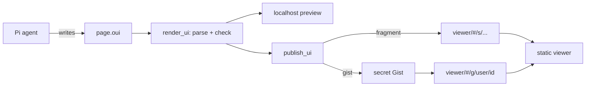

# Design: shareable OpenUI pages from Pi

Status: draft. Working name: `pi-artifacts`. The npm name is not decided.

## Goal

A Pi user asks the agent for a page. The agent writes the page in
[OpenUI Lang](https://www.openui.com/docs/openui-lang). The user previews it
on localhost. Then the user publishes it and gets a link. Anyone with the link
can open the page in a browser. The viewer of the page does not need Pi, an
account, or a login.

This is the model of Claude artifacts, with these differences:

- The agent writes OpenUI Lang, not HTML or JavaScript.
- Pages live in the link itself or in a secret GitHub Gist. We run no backend.
- The Pi package and the viewer are open source.

## Why OpenUI Lang

A page in OpenUI Lang can only use components from the viewer's component
library. It has no raw HTML and no scripts. The viewer runs only its own code,
so a shared page cannot run code that a model wrote. An HTML page needs a
sandbox for the same result.

A page is also small. OpenUI reports about 1,400 output tokens for each screen.
After compression, most pages fit in a URL.

## Parts

The project has three parts:

1. **The Pi package.** Tools, commands and a skill. It runs in Node inside Pi.
2. **The viewer.** A static Vue app on GitHub Pages. It renders pages with
   our component library.
3. **The component library.** Vue components on
   [frappe-ui](https://github.com/frappe/frappe-ui), with a Zod schema for
   each. The viewer renders them. The Pi package uses their schemas and
   prompt.
4. **Storage adapters.** Code that writes a page to a link (in Pi) and reads it
   back (in the viewer). Version 1 has two adapters: `fragment` and `gist`.



## OpenUI version

The Vue renderer, `@openuidev/vue-lang` 0.4.2, uses `@openuidev/lang-core`
0.4. It reads OpenUI Lang 0.5, not 1.0. The 1.0 features need the React
renderer. These 1.0 features are not available:

- A lone action without `Action([...])`.
- Custom `@Name(...)` functions and actions.
- The stored message format (`]]>openui:content`).
- The `type-mismatch`, `unknown-function` and `no-root` error codes.

The statement syntax of 1.0 is the same as 0.5. Pages that we write now
should render when `vue-lang` moves to 1.0.

The Pi package and the viewer must use the same `lang-core` version. If they
do not, `render_ui` can accept a page that the viewer cannot render. We pin
one version in the workspace root.

## Page format

A page has two files:

```text
page.oui    # OpenUI Lang 0.5
page.json   # metadata
```

```json
{
  "format": 1,
  "lang": "0.5",
  "library": "0.1.0",
  "title": "Q3 revenue",
  "created": "2026-10-31T10:00:00Z",
  "data": {}
}
```

- `format` is the version of this file layout.
- `library` is the component library version. The viewer shows a warning when
  a page needs a newer library.
- `data` holds snapshot data. See [Live data](#live-data).

## Pi package

### Tools

| Tool             | What it does                                                         |
| ---------------- | -------------------------------------------------------------------- |
| `scaffold_ui`    | Make an empty page bundle and return the path of `page.oui`.          |
| `render_ui`      | Parse and check the page, then show it in the localhost preview.      |
| `publish_ui`     | Publish the page and return the link. Asks the user first.            |
| `unpublish_ui`   | Delete the Gist of a published page.                                  |
| `list_ui`        | List local pages and their published links.                          |
| `import_ui`      | Read a page from a link into a new local bundle, to remix it.         |

`render_ui` parses the page with `createParser()` from
`@openuidev/lang-core` 0.4. It returns each parser error to the agent, with
the statement ID. The agent fixes the page and calls `render_ui` again. This
is the same loop as a compiler error.

The 0.4 parser reports only four error codes: `missing-required`,
`null-required`, `unknown-component` and `excess-args`. It renders what it
can and does not check prop types. `render_ui` adds two checks:

1. Check the props of each element against the Zod schema of its component.
2. Report the names in `meta.unresolved` and `meta.orphaned`.

The Pi package does not import Vue. The library build writes
`library.spec.json` (from `library.toJSONSchema()`) and `prompt.md` (from
`library.prompt()`). The Pi package reads these two files.

### Commands

| Command      | What it does                                      |
| ------------ | ------------------------------------------------- |
| `/ui`        | Open the localhost gallery of local pages.        |
| `/share`     | Publish the current page. Same as `publish_ui`.   |

### Skill

The skill teaches the agent the workflow and the component library. The
component reference comes from `library.prompt()`, so it always matches the
library. The skill loads only when the agent works on a page. Other turns do
not pay for the component reference.

### Storage

Local bundles live in `~/.pi/ui/<id>/`:

```text
manifest.json   # id, title, session, workspace, published links
page.oui
page.json
```

## Viewer

The viewer is a static single-page app. It uses Vue 3, Vite,
`@openuidev/vue-lang` and our component library. The localhost preview in Pi
serves the same build, so the preview and the shared page look the same.

### Routes

GitHub Pages cannot route paths in a single-page app. All routes are in the
URL fragment:

| Route                         | Source                                        |
| ----------------------------- | --------------------------------------------- |
| `#/s/<version>.<payload>`     | The page is in the fragment.                  |
| `#/g/<user>/<gist-id>`        | The page is in a secret Gist.                 |

### Features

- Render the page, with light and dark themes.
- Show the source.
- Copy a remix command: `pi "remix <link>"`.
- Download the page as one HTML file.
- Print.

## Storage adapters

### `fragment`

1. Put `page.json` and `page.oui` in one JSON object:
   `{"meta": {...}, "source": "..."}`.
2. Compress the object with raw deflate.
3. Encode the result as base64url.
4. Put it in the fragment: `#/s/1.<payload>`.

The viewer reverses this with `DecompressionStream("deflate-raw")`.

Browsers do not send the fragment to the server. GitHub Pages never sees the
page. A link cannot be changed or deleted, because the link is the page.

### `gist`

1. Run `gh gist create` with `page.oui` and `page.json`. Gists are secret by
   default.
2. Return `#/g/<user>/<gist-id>`.

The viewer reads both files from
`https://gist.githubusercontent.com/<user>/<gist-id>/raw/<file>`. This
endpoint sends `Access-Control-Allow-Origin: *` and does not have the API
rate limit. It caches for 300 seconds, so an update can take 5 minutes to show. The GitHub
API (`api.github.com/gists`) allows 60 requests an hour for each IP without a
login, so the viewer does not use it.

To update a page, `publish_ui` edits the same Gist. To delete a page,
`unpublish_ui` deletes the Gist.

A secret Gist is not private. Anyone with the link can read it.

### Which adapter

- If the fragment link is 8 KB or less, use `fragment`.
- If the link is longer than 8 KB, use `gist`.
- If the user asks for a link that can be updated or deleted, use `gist`.

The 8 KB limit is a guess. Some chat apps cut long links. We test it in phase 1.

## Live data

`Query()` in OpenUI Lang calls a tool through a `toolProvider`. A viewer of a
shared page has no Pi and no tools. Shared pages must not call tools.

Instead, `publish_ui` takes a snapshot:

1. Run each `Query()` in Node with `createQueryManager()`, with Pi tools as
   the `toolProvider`.
2. Replace each `Query()` statement with its result as a literal value.
3. Remove all `Mutation()` statements and the buttons that run them.

The user builds a page with live data in the preview and shares a snapshot.
Phase 1 has no `Query()` support. Phase 2 adds it.

## Security and privacy

### For people who open a page

- The viewer passes no `toolProvider` to the renderer.
- `@ToAssistant` does nothing in the viewer.
- `@OpenUrl` accepts only `https:` links. The viewer shows the target and asks
  before it opens the link.
- The viewer sets a Content Security Policy: no inline scripts, and
  `connect-src` limited to `gist.githubusercontent.com`.
- Image and link components accept only `https:` and `data:` URLs.
- Our `Markdown` component uses `markdown-it` with `html: false`. It does not
  render raw HTML.

### For the person who shares a page

Publishing sends content to a public place. `publish_ui` always:

1. Shows the title, the adapter and the size of the page.
2. Scans the page for secrets: API keys, tokens, private keys, passwords.
3. Asks the user to confirm in the TUI.

`lang-core` sends pseudonymous telemetry from its `postinstall` script. Our
package cannot stop this script. The README tells users to set
`OPENUI_TELEMETRY_DISABLED=1` before they install. Runtime telemetry is off
unless the user turns it on.

## Component library

`vue-lang` has no built-in components. We write each component in Vue with
`defineComponent()` from `vue-lang` and a Zod schema for its props. Each
component wraps a frappe-ui component when one exists.

frappe-ui 1.1 needs Vite and Tailwind 3. The library uses only frappe-ui
components. It does not use the data-fetching parts (`createResource` and
others), because they expect a Frappe server.

Phase 1 has these components:

| Group   | Components                                              | frappe-ui source        |
| ------- | ------------------------------------------------------- | ----------------------- |
| Layout  | `Stack`, `Grid`, `Card`, `Tabs`, `Divider`              | `Tabs`, `Divider`       |
| Text    | `Heading`, `Markdown`, `Alert`, `Badge`                 | `Alert`, `Badge`        |
| Data    | `Table`, `List`, `KeyValue`, `Progress`                 | `frappe-ui/list`, `Progress` |
| Charts  | `NumberCard`, `BarChart`, `LineChart`, `AreaChart`, `DonutChart` | `frappe-ui/charts` |
| Input   | `Button`, `TextInput`, `Select`, `Checkbox`, `Switch`   | same names              |

The charts use ECharts, which is large. The viewer loads the chart
components only when a page uses one.

Phase 3 adds components for code and reports:

- For code: `Diff`, `FileTree`, `StackTrace`, `TestRun`, `CommandOutput`,
  `CodeRef`.
- For reports: `Timeline`, `DependencyGraph`, `PRCard`.

A shared page can only use components that the public viewer has. Each
library version stays in the viewer. Old links continue to render.

## Repository layout

The repository is an npm workspace:

```text
packages/
  library/   # Vue components, Zod schemas, build of spec and prompt
  viewer/    # Vue app for GitHub Pages and the localhost preview
  pi/        # the Pi package: tools, commands, skill, adapters
```

## Phases

1. **Share a page.** `scaffold_ui`, `render_ui`, `publish_ui` with
   `fragment` and `gist`, `unpublish_ui`, `list_ui`. The viewer on GitHub
   Pages with the phase 1 components.
2. **Live data.** `Query()` in the preview, and snapshots on publish.
   `import_ui` and remix.
3. **Own components.** The code and report components, and library versions.
4. **Live preview while the agent writes.** Render the page from the
   `message_update` events, before the tool call ends.

## Open questions

- The npm name and the viewer domain.
- When does `vue-lang` move to `lang-core` 1.x?
- Does `createQueryManager()` from `lang-core` 0.4 work in Node?
- What is the gzip size of the viewer with frappe-ui and the charts?
- What link length do Slack, WhatsApp and Raven accept?
- Do `message_update` events contain partial tool call arguments?

## References

- [OpenUI Lang specification](https://www.openui.com/docs/openui-lang/specification)
- [OpenUI Lang 0.5 specification](https://www.openui.com/docs/openui-lang/specification/v0.5)
- [`@openuidev/lang-core`](https://github.com/thesysdev/openui/tree/main/packages/lang-core)
- [`@openuidev/vue-lang`](https://github.com/thesysdev/openui/tree/main/packages/vue-lang)
- [frappe-ui](https://github.com/frappe/frappe-ui)
- [pi-artifacts by jakeryderv](https://github.com/jakeryderv/pi-artifacts)
- [Pi extensions](https://pi.dev/)
